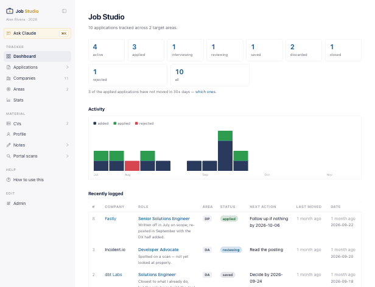

# jobstudio

An agent-native job-search toolkit: track companies, log applications, tailor a CV per
role, draft cover letters, and scan ATS job boards for new postings — driven end to end
from a Claude Code session, with a local Django web app for browsing.



*The web app, running against the bundled example job search — so this is exactly what
you get from `--from-example`, before putting any of your own data in. `tools/run-demo`
brings up this same thing in one command, without touching a data root of your own.*

---

## Features

- **It is yours to change.** Almost everything deciding *how* this behaves is prose you
  edit, not code you fork — how a CV gets tailored, how a posting is scored, what a
  cover letter sounds like, which questions an interview prep asks. 
- **No API key needed.** Every workflow runs inside your Claude Code session — CV
  tailoring and scan scoring included. There is nothing to bill and no key to hold.
- **Your data is yours, and separate.** Your CVs, applications, research and tracker
  live in a directory you choose, outside this repo. Nothing personal is ever committed
  here, and there is no account, no server and nothing phoning home.
- **It reads the job boards for you.** One command rescans every company you track
  across Greenhouse, Lever, Ashby, Workable, Workday, SmartRecruiters, BambooHR,
  Teamtailor, Pinpoint, UKG, SuccessFactors and more, filters by location, scores what is left against what you
  actually want, and writes you a report. It never writes to your tracker — the
  decision stays yours.
- **A CV and cover letter per application**, drawn from your own base CV and the role's
  description, plus a gap analysis telling you where you fall short *before* you apply.
  Logging a role is deliberately light — a copy of your CV and a thin draft letter to
  edit — and a full tailoring pass on either is one command away, for the roles that
  earn it.
- **It remembers, so you don't.** Every application keeps its job description, notes,
  documents and status history in a folder, and the web app makes the whole search
  browsable — what is outstanding, what went quiet, what you said to whom.
- **Plain files all the way down.** Markdown and sqlite, no proprietary format. If you
  stop using this tomorrow, everything you wrote is still readable.

## Quick start

Everything is a `/jobstudio` command in a Claude Code session opened in the clone.
Everything it writes lands in your data root, where the web app picks it up. A first
week with it looks something like this:

1. **Say what you're after.** `/jobstudio stocktake` is a guided interview about what
   you have done and what you want next. It writes your career profile: dealbreakers,
   salary floor, what motivates you. Every later score, CV and letter reads it.
2. **Track the companies you'd work for.** `/jobstudio company Grafana Labs` adds it to
   the tracker with researched notes: what they sell, to whom, and who pays.
3. **Scan their job boards.** `/jobstudio scan` reads every tracked company's ATS
   board, drops roles that fail your location rules, scores the rest against your
   target areas, and writes a report. Nothing goes into the tracker until you say so.
4. **Log a role you want.** `/jobstudio application <posting URL>` gives it a folder:
   the job description, a gap analysis with pros, cons and unknowns, a copy of your CV,
   and a short draft cover letter.
5. **Tailor for the roles that earn it.** `/jobstudio cv #12` rewrites the CV against
   the job description, and `/jobstudio cover-letter #12` writes the full letter.
   `/jobstudio render #12` turns both into `.docx`.
6. **Prepare for the interview.** `/jobstudio interview #12 --stage hiring-manager`
   writes the likely questions, answers drawn from your own stories, and questions to
   ask them. `/jobstudio dossier #12` puts the whole application into one Word file to
   read the evening before.
7. **See where it all stands.** `/jobstudio status` in the terminal, or the web app's
   dashboard: what's outstanding, what went quiet, what's next.

To see all of it before putting in any data of your own, `tools/run-demo` serves the
web app on the bundled example search. `/jobstudio help` lists every command.

## Installing it

| | |
|---|---|
| **Python ≥ 3.11** | The only thing you need installed beforehand. `init` builds the virtualenv and installs the dependencies itself |
| **[Claude Code](https://claude.com/claude-code)** | How you drive the toolkit. Every workflow is a `/jobstudio` command in a session opened in the clone |
| **git** | To clone it |
| **macOS or Linux** | Windows is out of scope: the `tools/` scripts are bash. It may work under WSL; nothing is built or tested for it |

```bash
git clone https://github.com/lambdamusic/jobstudio.git && cd jobstudio
claude                      # then: /jobstudio init
tools/run-dev-local-db      # the web app, at http://127.0.0.1:8010, in its own terminal
```

The skill ships in the repo, so a session opened in the clone can run `/jobstudio init`
straight away. It finds or creates the virtualenv (asking first), sets up a data root
wherever you want it, wires the two together, and checks the result. It also asks how
you want to start: from the example job search, from a CV you have, from what it can
find about you online, or from a blank interview.

**Take your time over `init`.** What you tell it drives every tailored CV, cover letter
and scan score after it, so a thin answer doesn't fail, it just makes everything
downstream less targeted.

**[docs/installation.md](docs/installation.md)** covers the rest: the same setup by
hand, signing in and changing the admin password, the configuration files, and the
checks to run if you are changing the code.

## The commands

| Command | |
|---|---|
| `/jobstudio init` | First-run setup: create a data root and wire this checkout to it |
| `/jobstudio company` | Track a company to watch, with researched notes |
| `/jobstudio application` | Log an application: folder, gap analysis, CV copy, draft cover letter |
| `/jobstudio cv` | Tailor a CV to a role, or rebuild/import your base CVs |
| `/jobstudio cover-letter` | Draft a cover letter from the application, CV and company notes |
| `/jobstudio render` | Turn an application's CV and cover letter into `.docx` |
| `/jobstudio stocktake` | Guided interview that builds your career profile |
| `/jobstudio interview` | Prep for a real interview: likely questions, STAR-grounded answers |
| `/jobstudio dossier` | Everything an application has gathered, in one Word file to read |
| `/jobstudio scan` | Scan tracked companies' ATS boards for new postings and score them |
| `/jobstudio status` | Where everything stands |

## Documentation

`docs/` is the long form, in two layers — see **[docs/README.md](docs/README.md)** for
the full index.

| | |
|---|---|
| **[docs/installation.md](docs/installation.md)** | Setup by hand, signing in, the web app, the configuration files, and the checks for anyone changing the code |
| **[docs/workflow.md](docs/workflow.md)** | Then here. The daily/weekly cadence: what to run, in what order. Every step is a Claude command |
| **The deep dives** | One guide per piece, for how something actually works rather than how to invoke it — [scanning and scoring](docs/portal-scan-and-scoring.md), [applications and gap analysis](docs/applications-and-gap-analysis.md), [the CV pipeline](docs/cv-pipeline.md), [cover letters](docs/cover-letters.md), [the career stocktake](docs/career-stocktake-profile.md), [interview prep](docs/interview-prep.md), [companies](docs/companies.md), [the dashboard](docs/dashboard-status.md) |
| **[docs/under-the-hood.md](docs/under-the-hood.md)** | The Python entry points and shell scripts the commands drive. You never need this to *use* the toolkit — only to debug a step, extend it, or automate it |

The same workflow summary is inside the web app at **`/help/`**, which is usually closer
to hand while you are looking at your search.

## How it is laid out

Two directories, deliberately:

```
jobstudio/                 # this repo — the code. Public, shareable, no personal data.
├── .claude/skills/jobstudio/   # the skill: SKILL.md + one file per subcommand
├── src/                          # pipeline scripts + the Django app
├── tools/                        # shell entry points
├── example-data/                 # a complete fictional job search, and the test fixture
└── docs/                         # how each piece works

<your data root>/            # your job search. Private, and yours.
├── config.yaml                   # who you are
├── jobs/                         # CVs, profile, companies, applications, scans
│   └── scan-config.yaml          # your ATS overrides + category→area mapping
├── exports/                      # one-off documents belonging to no folder
│                                 #   (renders go beside their source — see docs/workflow.md)
├── backups/django/               # timestamped database dumps
└── db.sqlite3                    # the tracker
```

`init` writes the link between them (`.jobstudio-data` here, `~/.jobstudio.ini` in your
home directory) along with a `tools/py` wrapper and, if you use them, a VS Code
workspace covering both folders.

Put the data root in a synced folder (Dropbox, Drive, iCloud). Nothing in it is
version-controlled, so the sync service is your backup — and `tools/db-dump` writes
timestamped snapshots alongside it.

## Project status

**Active development.** This works and is used daily for a real job search — but by a
small number of people, so expect the things a new user finds first: assumptions nobody
knew were assumptions, and error messages that made sense to whoever wrote them.

Issues and pull requests welcome — a confusing error, or a step that didn't work as
written, is exactly the useful kind of report.

## Licence

MIT — see `LICENSE`.
