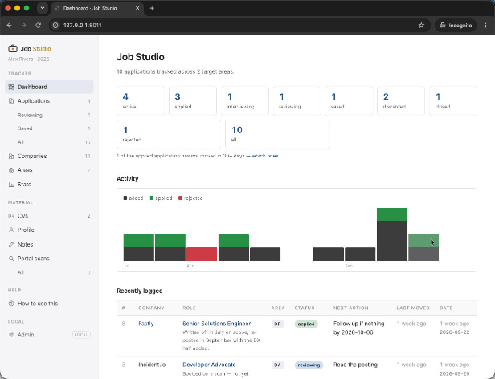

# jobstudio

An agent-native job-search toolkit: track companies, log applications, tailor a CV per
role, draft cover letters, and scan ATS job boards for new postings — driven end to end
from a Claude Code session, with a local Django web app for browsing.



*The web app, running against the bundled example job search — so this is exactly what
you get from `--from-example`, before putting any of your own data in. `tools/run-demo`
brings up this same thing in one command, without touching a data root of your own.*

---

## Features

- **It is yours to change.** Almost everything deciding *how* this behaves is prose you
  edit, not code you fork — how a CV gets tailored, how a posting is scored, what a
  cover letter sounds like, which questions an interview prep asks. Each is a markdown
  file written in English, mostly under `.claude/skills/jobstudio/`, that you are meant
  to open and argue with. If the scoring rubric is wrong for your field, rewrite it
  (`src/prompts/scan_score_rubric.md`); if the letters read like someone else, change
  the structure file (`references/cover-letter-structures.md`). Nobody else gets to
  decide what "a good match" means for your search.
- **No API key needed.** Every workflow runs inside your Claude Code session — CV
  tailoring and scan scoring included. There is nothing to bill and no key to hold.
- **Your data is yours, and separate.** Your CVs, applications, research and tracker
  live in a directory you choose, outside this repo. Nothing personal is ever committed
  here, and there is no account, no server and nothing phoning home.
- **It reads the job boards for you.** One command rescans every company you track
  across Greenhouse, Lever, Ashby, Workable, Workday, SmartRecruiters, BambooHR,
  Teamtailor, Pinpoint, UKG, SuccessFactors and more, filters by location, scores what is left against what you
  actually want, and writes you a report. It never writes to your tracker — the
  decision stays yours.
- **A CV and cover letter per application**, drawn from your own base CV and the role's
  description, plus a gap analysis telling you where you fall short *before* you apply.
  Logging a role is deliberately light — a copy of your CV and a thin draft letter to
  edit — and a full tailoring pass on either is one command away, for the roles that
  earn it.
- **It remembers, so you don't.** Every application keeps its job description, notes,
  documents and status history in a folder, and the web app makes the whole search
  browsable — what is outstanding, what went quiet, what you said to whom.
- **Plain files all the way down.** Markdown and sqlite, no proprietary format. If you
  stop using this tomorrow, everything you wrote is still readable.

## Prerequisites

| | |
|---|---|
| **Python ≥ 3.11** | The only thing you need installed beforehand. `init` builds the virtualenv and installs the dependencies itself |
| **[Claude Code](https://claude.com/claude-code)** | How you drive the toolkit. Every workflow is a `/jobstudio` command in a session opened in the clone |
| **git** | To clone it |
| **macOS or Linux** | Windows is out of scope: the `tools/` scripts are bash. It may work under WSL; nothing is built or tested for it |

## Quick start

```bash
git clone https://github.com/lambdamusic/jobstudio.git && cd jobstudio
claude                      # then: /jobstudio init
```

**That is the whole thing.** The skill ships in the repo, so a Claude Code session
opened in the clone can already run `/jobstudio init` — it finds or creates the
virtualenv (asking first), sets up a data root wherever you want it, wires the two
together, and checks the result. It also asks *how* you want to start: from the example
job search, from a CV you have, from what it can find about you online, or from a blank
interview.

**It is worth taking your time over.** What you tell `init` is written into your data
root and then drives every tailored CV, every cover letter and every scan score after
it — so a thin answer here doesn't fail, it just quietly makes everything downstream
less targeted. Tell it as much as you can about what you have done and what you want
next. (`/jobstudio stocktake` is where the rest gets captured, and `init` will point
you at it.)

**Then start the web app** — it is how you actually look at any of this:

```bash
tools/run-dev-local-db          # http://127.0.0.1:8010
```

Leave it running in its own terminal; it serves until you stop it with Ctrl-C. Browsing
needs no login. The agent can start it for you too, but it holds that session until you
interrupt it, so a separate terminal is usually what you want.

**[docs/getting-started.md](docs/getting-started.md)** covers the rest: doing the same
setup by hand, signing in and changing the admin password, what to do once it is
running, the configuration files, and the checks to run if you are changing the code.

## The commands

| Command | |
|---|---|
| `/jobstudio init` | First-run setup: create a data root and wire this checkout to it |
| `/jobstudio company` | Track a company to watch, with researched notes |
| `/jobstudio application` | Log an application: folder, gap analysis, CV copy, draft cover letter |
| `/jobstudio cv` | Tailor a CV to a role, or rebuild/import your base CVs |
| `/jobstudio cover-letter` | Draft a cover letter from the application, CV and company notes |
| `/jobstudio stocktake` | Guided interview that builds your career profile |
| `/jobstudio interview` | Prep for a real interview: likely questions, STAR-grounded answers |
| `/jobstudio scan` | Scan tracked companies' ATS boards for new postings and score them |
| `/jobstudio status` | Where everything stands |

## Documentation

`docs/` is the long form, in two layers — see **[docs/README.md](docs/README.md)** for
the full index.

| | |
|---|---|
| **[docs/getting-started.md](docs/getting-started.md)** | Setup by hand, signing in, the web app, the configuration files, and the checks for anyone changing the code |
| **[docs/workflow.md](docs/workflow.md)** | Then here. The daily/weekly cadence: what to run, in what order. Every step is a Claude command |
| **The deep dives** | One guide per piece, for how something actually works rather than how to invoke it — [scanning and scoring](docs/portal-scan-and-scoring.md), [applications and gap analysis](docs/applications-and-gap-analysis.md), [the CV pipeline](docs/cv-pipeline.md), [cover letters](docs/cover-letters.md), [the career stocktake](docs/career-stocktake-profile.md), [interview prep](docs/interview-prep.md), [companies](docs/companies.md), [the dashboard](docs/dashboard-status.md) |
| **[docs/under-the-hood.md](docs/under-the-hood.md)** | The Python entry points and shell scripts the commands drive. You never need this to *use* the toolkit — only to debug a step, extend it, or automate it |

The same workflow summary is inside the web app at **`/help/`**, which is usually closer
to hand while you are looking at your search.

## How it is laid out

Two directories, deliberately:

```
jobstudio/                 # this repo — the code. Public, shareable, no personal data.
├── .claude/skills/jobstudio/   # the skill: SKILL.md + one file per subcommand
├── src/                          # pipeline scripts + the Django app
├── tools/                        # shell entry points
├── example-data/                 # a complete fictional job search, and the test fixture
└── docs/                         # how each piece works

<your data root>/            # your job search. Private, and yours.
├── config.yaml                   # who you are
├── jobs/                         # CVs, profile, companies, applications, scans
│   └── scan-config.yaml          # your ATS overrides + category→area mapping
├── exports/                      # one-off documents belonging to no folder
│                                 #   (renders go beside their source — see docs/workflow.md)
├── backups/django/               # timestamped database dumps
└── db.sqlite3                    # the tracker
```

`init` writes the link between them (`.jobstudio-data` here, `~/.jobstudio.ini` in your
home directory) along with a `tools/py` wrapper and, if you use them, a VS Code
workspace covering both folders.

Put the data root in a synced folder (Dropbox, Drive, iCloud). Nothing in it is
version-controlled, so the sync service is your backup — and `tools/db-dump` writes
timestamped snapshots alongside it.

## Project status

**Active development.** This works and is used daily for a real job search — but by a
small number of people, so expect the things a new user finds first: assumptions nobody
knew were assumptions, and error messages that made sense to whoever wrote them.

Issues and pull requests welcome — a confusing error, or a step that didn't work as
written, is exactly the useful kind of report.

## Licence

MIT — see `LICENSE`.
