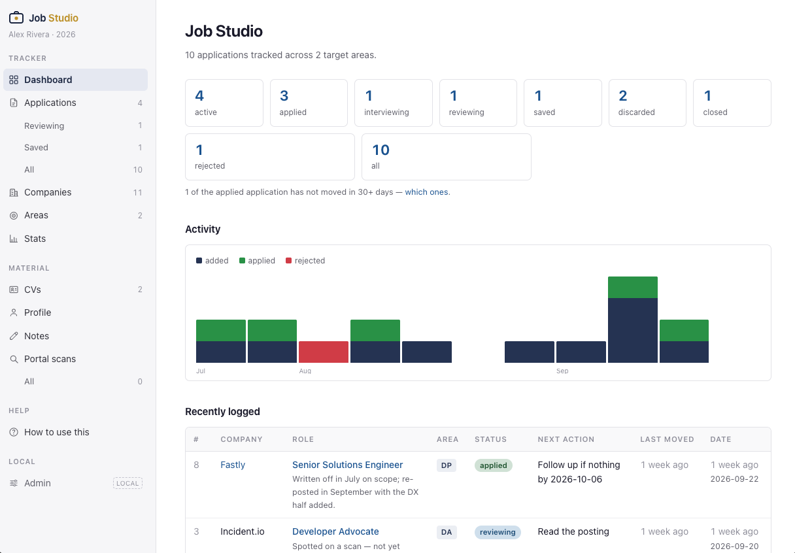
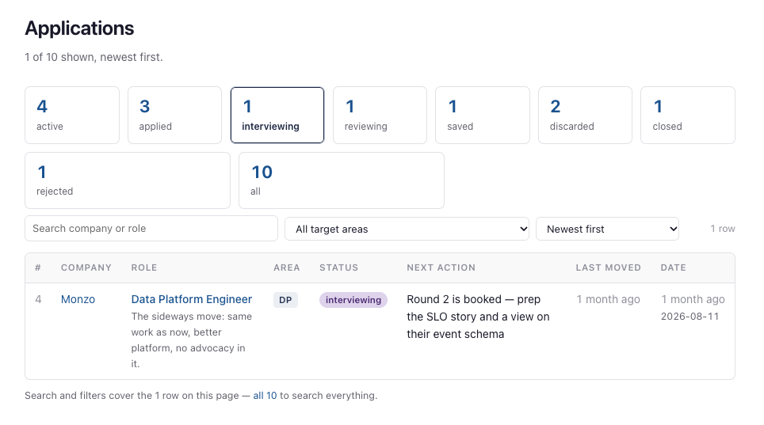
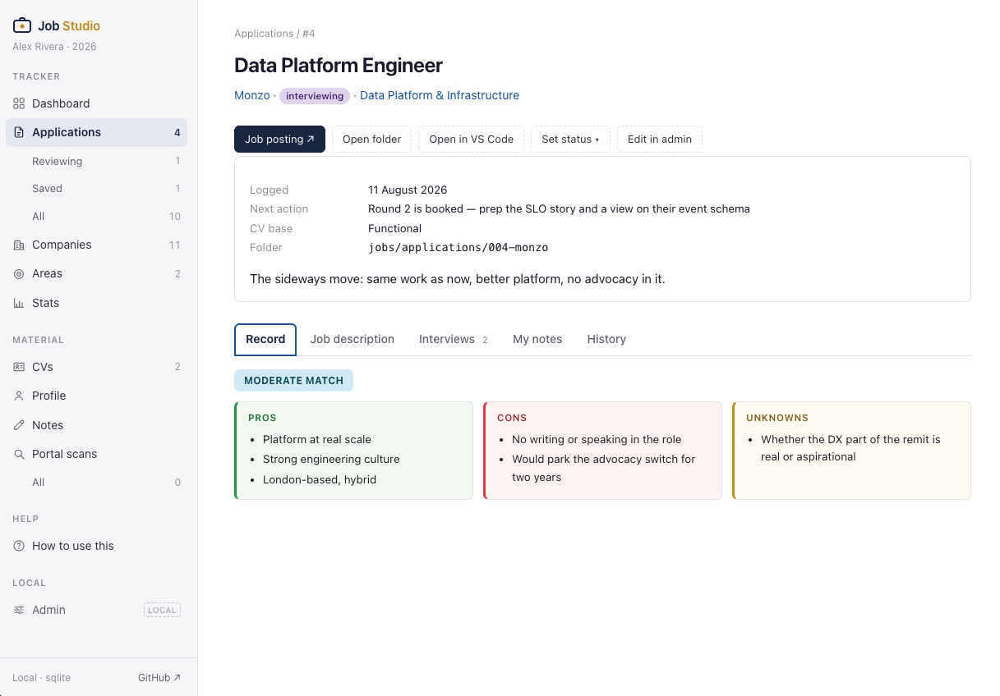
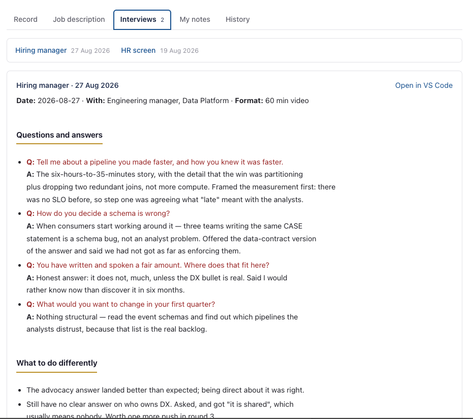
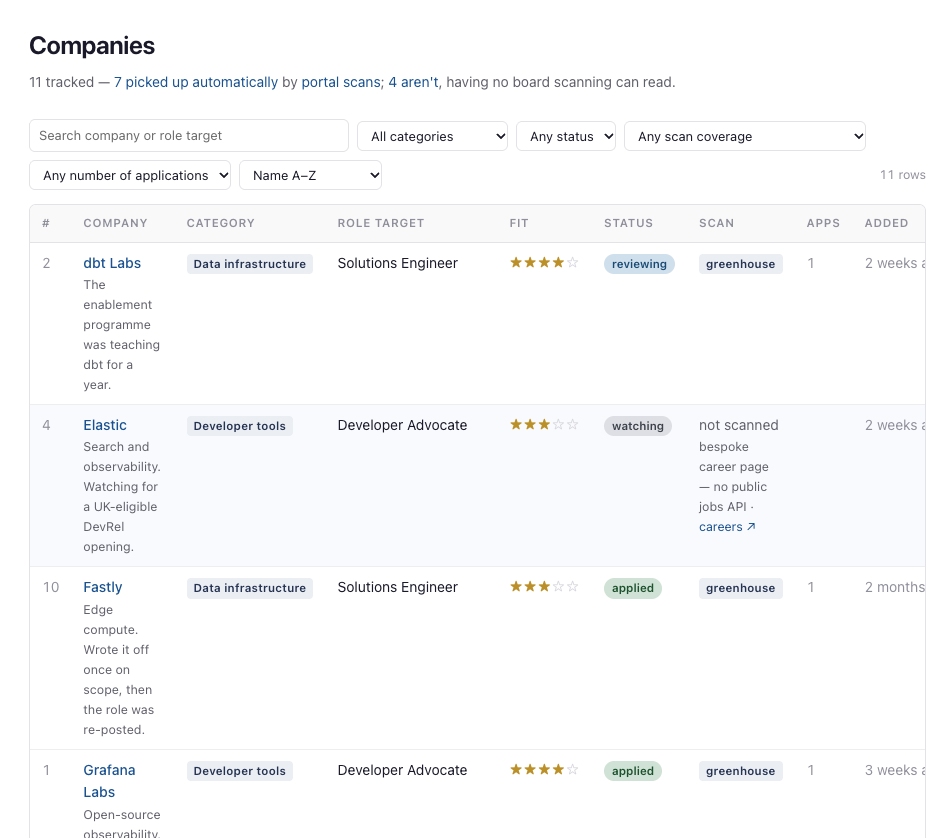
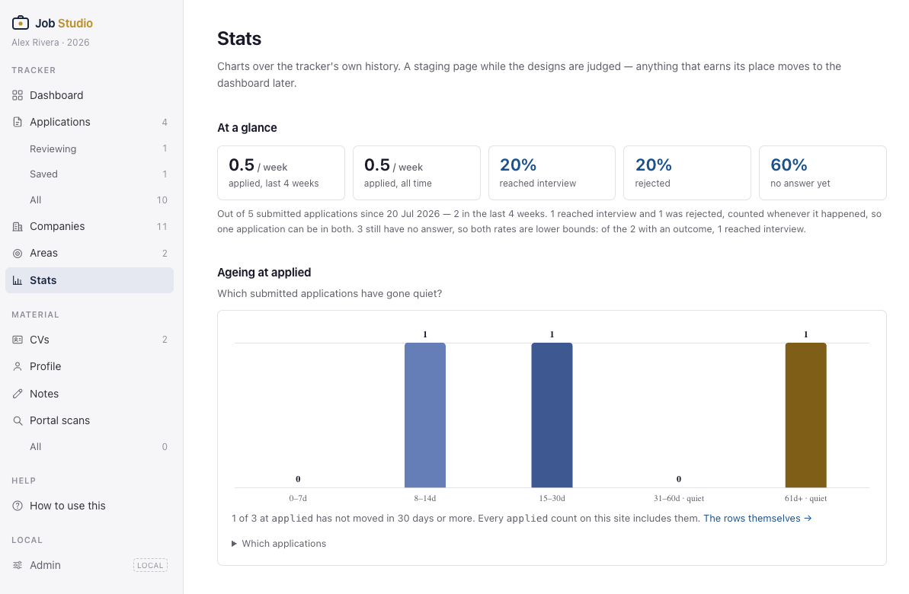
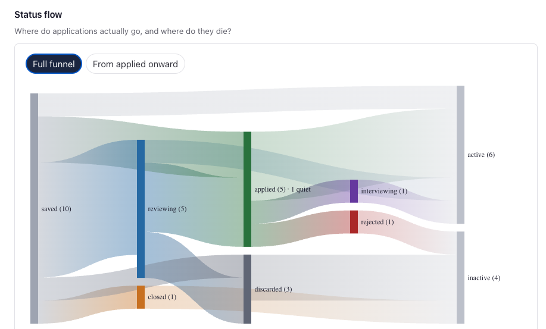
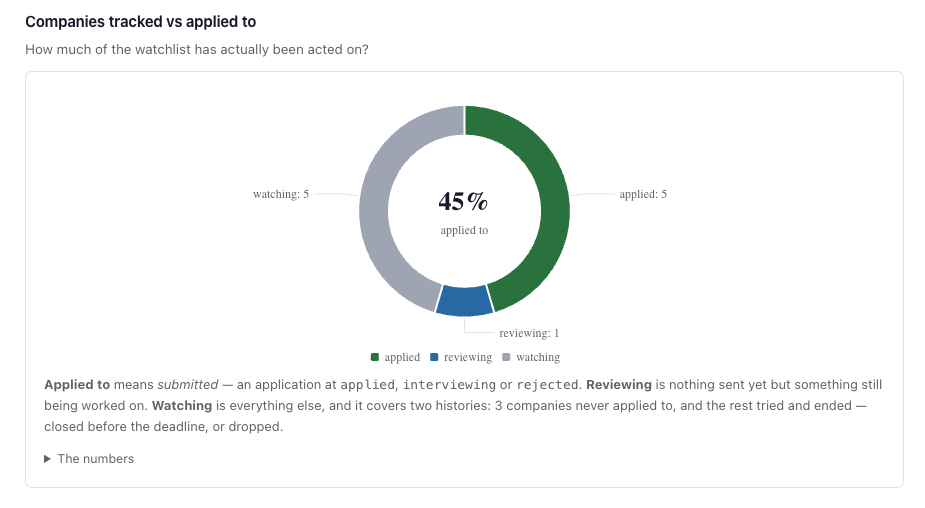
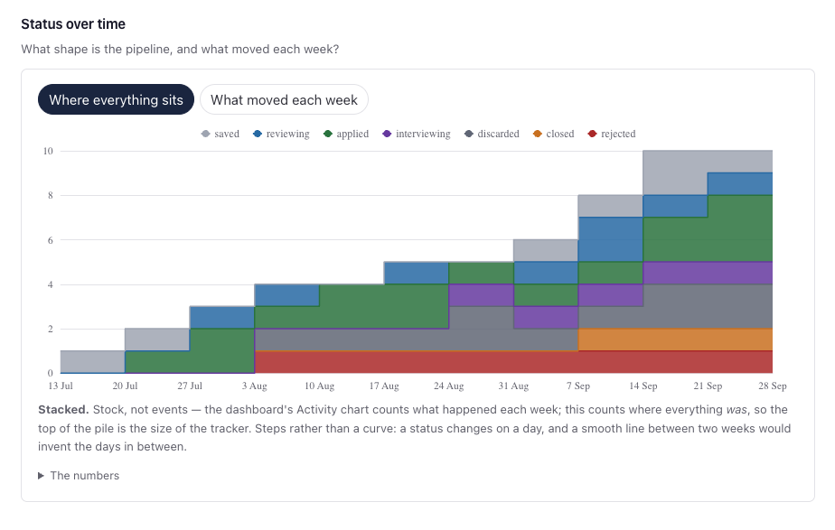
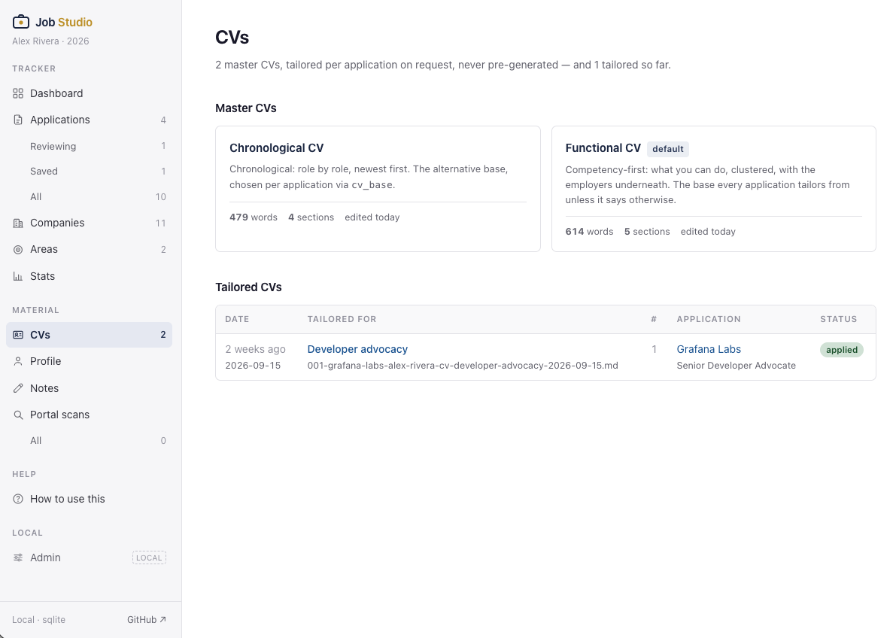

# Screenshots

A tour of the web app, page by page — the same ground the
[intro animation](images/quick-intro.gif) covers, but still, captioned, and linkable.

Everything here is the **example data set** that ships with the repo: Alex Rivera is a
fictional job-seeker, and every company, note, interview and number below is synthetic.
You can bring this exact app up yourself with `tools/run-demo` (see
[under-the-hood.md](under-the-hood.md#the-web-app)) — it serves `example-data/` from a
throwaway copy, so it touches nothing of your own.

The app is read-mostly by design. The agent writes the files, `import_jobs` turns them
into rows, and these pages are where you *look* at the result and nudge a status.

---

## Tracker

### Dashboard

The landing page, and the only one built to be read in ten seconds. The counts across
the top are the pipeline by status; the line beneath them is the one that earns the
page its place — *"1 of the applied applications has not moved in 30+ days"*, with a
link straight to the offenders. The activity chart is **events**, not stock: what was
added, applied and rejected each week. `/jobstudio status` prints the same figures in
the terminal from the same queries, for when you are already in a session.

### Applications — the list

Every logged role, newest first, filterable by status chip, target area and free text.
Each row carries the thing you actually need to decide anything — the **next action**,
and how long it has been since the application last moved. The footer is deliberately
pedantic about scope: *"Search and filters cover the 1 row on this page — all 10 to
search everything"*, because a filtered search that silently searches only the filtered
set is how you conclude you never applied somewhere you did.

### An application — the record

One application, with its folder on disk one click away — `Open folder`, `Open in VS
Code`, and `Job posting` out to the original advert. The metadata block names which base
CV this role tailors from (`cv_base`), which is the hook the
[CV pipeline](cv-pipeline.md) reads later.

Below it is the gap analysis as the agent wrote it: a match verdict, then **pros, cons
and unknowns** side by side. The unknowns column is the useful one and the easiest to
skip when writing these by hand — *"whether the DX part of the remit is real or
aspirational"* is a question for the next call, not a weakness.

### An application — the interviews

Every round against the same application, each one a file in the application folder.
Questions are rendered in red and answers in black — the colouring keys off the
`- **Q:**` / `**A:**` markers, so a round file that uses them gets this layout for free.

Each round ends with **what to do differently**, which is the part that compounds: by
round three you are reading your own notes on what landed, not reconstructing them.
`/jobstudio interview` drafts these from the job description and the career profile,
and you overwrite the answers with what you actually said.

## Companies

The watchlist — companies worth an application that has not necessarily happened yet.
Two columns do the work here. **Fit** is the star rating from your
[stocktake profile](career-stocktake-profile.md), and **scan** is whether the careers
page is machine-readable: a named ATS means `/jobstudio scan` will pick up new postings
automatically, while *"not scanned — bespoke career page, no public jobs API"* means
that one is on you to check.

The header keeps the count honest: *"11 tracked — 7 picked up automatically by portal
scans; 4 aren't."* Knowing which four is the whole point.

## Stats

A staging area for charts, explicitly labelled as such on the page: anything that earns
its keep moves to the dashboard later. Each chart carries its own caption explaining
what it counts, because every one of them has an edge case that makes a naive reading
wrong.

### At a glance, and ageing

Rates over the tracker's own history, with the sample size stated rather than implied —
*"out of 5 submitted applications since 20 Jul"*. The outcome percentages are called
**lower bounds** on purpose: 60% have no answer yet, so a 20% interview rate can only
go up.

The bars underneath are the ones to act on. They bucket submitted applications by how
long they have sat without moving, and everything past 30 days is labelled **quiet** —
a polite word for needing a nudge or a write-off.

### Status flow

Where applications actually go, and where they die. The toggle matters: **full funnel**
starts at `saved` and so is dominated by pre-application attrition — roles discarded
before anything was ever sent. **From applied onward** drops that and shows only what
happened to real submissions, which is the view to use when asking whether your CV is
working rather than whether your filtering is.

### Tracked vs applied to

How much of the watchlist has been acted on. The caption does the real work, because
*"watching"* is a single slice covering two opposite histories: companies never applied
to, and companies tried and finished — closed before the deadline, or dropped. A low
number here is either a healthy filter or a stalled search, and the chart deliberately
will not tell you which.

### Status over time

**Stock, not events** — the complement to the dashboard's activity chart. This counts
where everything *was* each week, so the top of the pile is the size of the tracker and
the bands below it are the shape of the pipeline.

Drawn as steps rather than a smooth curve, which is a correctness choice, not a
stylistic one: a status changes on a given day, and interpolating between two weekly
samples would invent days that never happened.

## Material

### CVs

The two base CVs, and every tailored copy made from them. **Functional** (competency
clusters, employers underneath) is the default; **chronological** (role by role, newest
first) is the alternative, chosen per application via `cv_base`.

The subtitle states the pipeline's one rule: *"tailored per application on request,
never pre-generated"*. There is no stored library of variants to keep in sync — a
tailored CV exists because you asked for one against a specific advert, and it is
listed here against the application it was written for. The full mechanics are in
[cv-pipeline.md](cv-pipeline.md).
